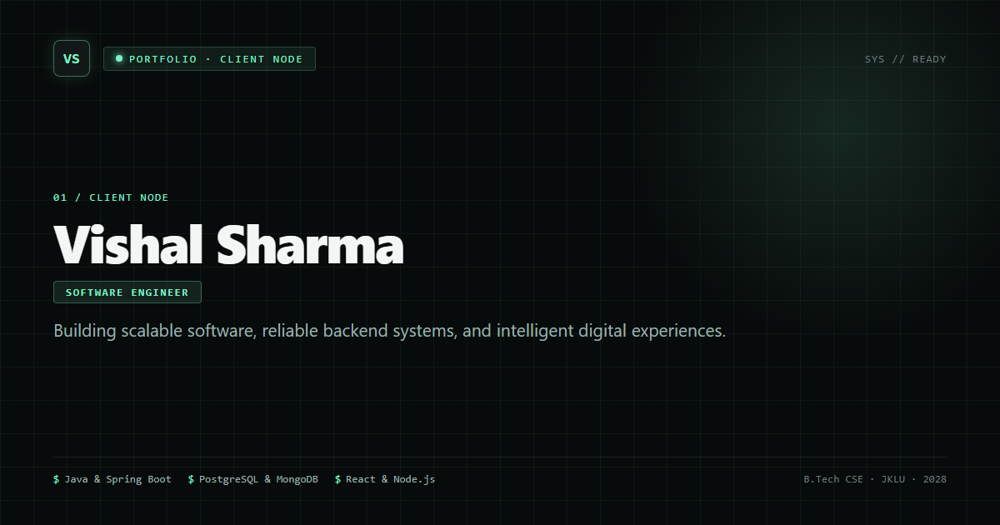

# Vishal Sharma — Full-Stack MERN Portfolio

A production-grade, fully responsive personal portfolio website engineered with the **MERN Stack** (React.js frontend, Node.js + Express.js backend REST API, and MongoDB Atlas database with Mongoose ODM). Designed as a living CV with real end-to-end database connectivity and server-side document delivery, the system models a full request path: **Browser → React SPA → Express API → MongoDB Atlas**, adhering to faculty requirements, responsive standards, and strict defensive security practices.



---

## 1. Live Deployments

> [!NOTE]
> Deployment in progress: links will be added here once cloud hosting pipelines are configured in Prompt 2.

- **Frontend (Netlify):** Deployment in progress: links will be added here
- **Backend API Health Check (Render):** Deployment in progress: links will be added here

---

## 2. Tech Stack & Version Specifications

| Technology | Version | Role in Architecture & Rationale |
|---|---|---|
| **Node.js** | `>=20.0.0` (LTS) | Server runtime supporting native ES Modules, modern Fetch API, and secure crypto primitives. |
| **React** | `^18.3.1` | Client UI library utilizing component-driven architecture, hooks, and Concurrent Mode. |
| **Vite** | `^5.4.9` | Ultra-fast client build tool providing optimized ES module development and production bundling. |
| **React Router DOM** | `^6.27.0` | Client-side routing for Single Page Application navigation (`/`, `/projects/:slug`, `/404`). |
| **Framer Motion** | `^11.11.9` | Declarative animation engine configured with `prefers-reduced-motion` compliance. |
| **Express.js** | `^4.21.1` | Minimalist HTTP web framework for REST API endpoints, routing, and defensive middleware. |
| **Mongoose** | `^8.7.1` | Object Data Modeling (ODM) for MongoDB schema validation, typed models, and sanitizeFilter queries. |
| **MongoDB Atlas** | `v7.0+` (M0 Free Tier) | Managed cloud document database providing indexed collection persistence for contact inquiries. |
| **Helmet** | `^8.0.0` | HTTP response header security middleware setting defensive headers (nosniff, frameguard, etc.). |
| **Zod** | `^3.23.8` | Strict TypeScript-first schema declaration and runtime input validation / data sanitization. |
| **Express Rate Limit** | `^7.4.1` | Defensive IP-based rate limiting on sensitive submission endpoints to mitigate spam and DoS. |
| **PDFKit** | `^0.15.0` | Server-side programmatic PDF generation engine compiling verified CV data to binary stream. |
| **Docx** | `^9.0.0` | Server-side programmatic Word (.docx) generation library producing compliant OpenXML documents. |
| **Netlify** | Platform | Static web hosting provider configured for SPA rewrites (`netlify.toml`) and security headers. |
| **Render** | Platform | Containerized cloud hosting platform running the Express Node.js background web service. |

---

## 3. Faculty Requirements & Evaluation Rubric

### Required Sections & Technical Checklist

| Requirement | Implementation Details | Code Path / File Location | How to Verify & Review |
|---|---|---|---|
| **Hero / Landing** | Animated introduction with Name (*Vishal Sharma*), Role (*Software Engineer*), Typewriter effect headline, Download CV button group (PDF & Word), and signal backdrop. | [`client/src/sections/Hero/Hero.jsx`](file:///client/src/sections/Hero/Hero.jsx) | Navigate to `/`. Observe animated name entrance, typewriter animation, and dual CV download buttons. |
| **About Me** | Professional summary, status (*Current Student · B.Tech CSE, JKLU, 2028*), location (*Jaipur, India*), portrait photo, and scroll-triggered fade entrance. | [`client/src/sections/About/About.jsx`](file:///client/src/sections/About/About.jsx) | Scroll to About section. Inspect portrait card, bio text, and academic status. |
| **Skills** | Grouped by category (*Frontend*, *Backend*, *Tools & Technologies*), qualitative proficiency badges (`CORE`, `WORKING`, `FAMILIAR`), and interactive project-association highlights. | [`client/src/sections/Skills/Skills.jsx`](file:///client/src/sections/Skills/Skills.jsx) | Scroll to Skills section. Filter categories, hover over skill cards, and inspect project association tags. |
| **Projects Showcase** | 3 featured projects (*SellerLensIQ*, *ClinicSaaS*, *Vaani Bill*) as interactive cards with descriptions, tech badges, live/repo links, category filters, and detail pages. | [`client/src/sections/Projects/Projects.jsx`](file:///client/src/sections/Projects/Projects.jsx)<br>[`client/src/pages/ProjectDetail.jsx`](file:///client/src/pages/ProjectDetail.jsx) | Filter projects by tag (e.g. React, Spring Boot), click "View Details", and verify `/projects/:slug` deep link. |
| **CV / Resume Download** | Served directly via Node.js/Express REST API routes (`/api/cv/pdf` and `/api/cv/docx`) generated from a single verified data source. | [`server/src/routes/cv.js`](file:///server/src/routes/cv.js)<br>[`server/scripts/generate-cv.js`](file:///server/scripts/generate-cv.js) | Click "PDF" or "DOCX" in Hero or Header. Check network tab: request is sent to Express backend and binary file downloads. |
| **Education & Experience Timeline** | Vertical git-graph styled timeline showing B.Tech in CSE at JK Lakshmipat University (2028) and backend internship at JGS Jaipur Global Services. | [`client/src/sections/Timeline/Timeline.jsx`](file:///client/src/sections/Timeline/Timeline.jsx) | Scroll to Timeline section. Review education milestones and verified internship timeline node. |
| **Certifications & Achievements** | Industry certifications from IBM (*Java Developer*, *Prompt Engineering*), Google (*AI Essentials*), and McKinsey.org (*Forward Program*) with verified credential links. | [`client/src/sections/Certifications/Certifications.jsx`](file:///client/src/sections/Certifications/Certifications.jsx) | Scroll to Certifications section. Click external verification links (`rel="noopener noreferrer"`). |
| **Contact Form (Backend Connected)** | Functional form with Name, Email, Message, client & server Zod validation, honeypot field, rate limiting, and MongoDB persistence. | [`client/src/sections/Contact/ContactForm.jsx`](file:///client/src/sections/Contact/ContactForm.jsx)<br>[`server/src/routes/contact.js`](file:///server/src/routes/contact.js) | Submit a test message. Check network response: 201 Created with persisted document ID. |
| **React Router SPA** | Single Page Application with client-side navigation (`/`, `/projects/:slug`, `/404`) and 404 fallback page. | [`client/src/routes.jsx`](file:///client/src/routes.jsx)<br>[`client/src/pages/NotFound.jsx`](file:///client/src/pages/NotFound.jsx) | Type an invalid URL (e.g. `/unknown`). Verify styled 404 page with return home button. |
| **Express REST API** | Clean REST API with health check, contact submission, and CV delivery routes. | [`server/src/app.js`](file:///server/src/app.js)<br>[`server/src/routes/`](file:///server/src/routes/) | Send `GET /api/health`. Returns `{ ok: true, status: "up", db: "connected", uptime, ts }`. |
| **MongoDB & Mongoose** | Strict schema validation, timestamps, createdAt index, and `sanitizeFilter` against NoSQL injection. | [`server/src/models/Message.js`](file:///server/src/models/Message.js)<br>[`server/src/config/db.js`](file:///server/src/config/db.js) | Verify contact submissions are validated and stored in `messages` collection. |
| **Responsive Design** | 11 viewports tested from 320px to 1920px + landscape phone with 0 horizontal overflow and no clipping. | [`client/src/styles/base.css`](file:///client/src/styles/base.css)<br>[`client/scripts/check-responsive.mjs`](file:///client/scripts/check-responsive.mjs) | Run `npm run check:responsive` in `client`. All 110 viewport/theme combinations pass with 0 overflow. |
| **Dark / Light Toggle** | Custom theme provider persisting choice to `localStorage`, responding to system `prefers-color-scheme`, with WCAG contrast. | [`client/src/hooks/useTheme.js`](file:///client/src/hooks/useTheme.js)<br>[`client/src/components/ThemeToggle/ThemeToggle.jsx`](file:///client/src/components/ThemeToggle/ThemeToggle.jsx) | Click theme toggle button in navigation header. UI toggles smoothly between dark and light palettes. |
| **Environment Variables** | Strictly segregated. Production variables kept in deployment dashboards; `.env` excluded from git. | [`.gitignore`](file:///.gitignore)<br>[`client/.env.example`](file:///client/.env.example)<br>[`server/.env.example`](file:///server/.env.example) | Check `git ls-files` to confirm zero `.env` files are tracked. Examples contain only safe dummy values. |

### Marking Rubric Breakdown (10 Marks Total)

| Rubric Criterion | Target & Standard | Implementation Verification |
|---|---|---|
| **1. UI Design & Responsiveness** | Clean layout, mobile-first, consistent tokens, dark/light theme. | Custom CSS variables in `tokens.css`; 0 overflow across 11 viewports (320px to 1920px); responsive audit suite. |
| **2. Animations & Interactivity** | Smooth scroll animations, typewriter effect, hover states, reduced-motion. | Framer Motion entrance effects, typewriter in Hero, card hovers, full `prefers-reduced-motion` compliance. |
| **3. MERN Stack Integration** | React SPA + Express API + MongoDB contact form working end-to-end. | Client `submitContact()` talks to Express `/api/contact`, validated by Zod, persisted via Mongoose. |
| **4. CV Download (PDF + DOCX)** | Both formats downloadable via working backend routes. | `GET /api/cv/pdf` and `GET /api/cv/docx` serve server-generated binary files with proper Content-Type headers. |
| **5. Projects & Content Quality** | Minimum 3 projects with real GitHub/live links and verified descriptions. | SellerLensIQ (Spring Boot/PostgreSQL), ClinicSaaS (Full-Stack), and Vaani Bill (Voice AI concept). |
| **6. Deployment Readiness** | Production build scripts, SPA rewrites, health checks, cloud blueprints. | `client/netlify.toml` with SPA redirects, `render.yaml` blueprint with `/api/health` monitoring. |
| **7. Code Quality & GitHub** | Clean folder structure, conventional commits, comprehensive README, no secrets. | Verified git history, zero exposed credentials, automated security audit script passing 29/29 checks. |

---

## 4. Project Structure

```text
portfolio/
├── .gitignore                     # Production ignore rules (excludes .env, node_modules, dist, etc.)
├── render.yaml                    # Render cloud infrastructure blueprint (Node web service)
├── README.md                      # Comprehensive project documentation and faculty verification guide
├── client/
│   ├── netlify.toml               # Netlify configuration: SPA redirect & Stage C defensive headers
│   ├── package.json               # Client dependencies, engines (node >=20), and audit scripts
│   ├── vite.config.js             # Vite configuration with React plugin
│   ├── .env.example               # Client environment variable placeholders
│   ├── scripts/
│   │   └── check-responsive.mjs   # Automated Playwright responsive QA audit suite (11 viewports x 2 themes)
│   ├── public/
│   │   ├── favicon.svg            # Custom SVG favicon
│   │   ├── og-image.png           # Open Graph social preview banner
│   │   └── robots.txt             # Search engine crawler instructions
│   └── src/
│       ├── main.jsx               # Client entrypoint with theme initialization
│       ├── routes.jsx             # React Router route configuration
│       ├── components/            # Reusable components (Header, Footer, TechCard, ProjectCard, etc.)
│       ├── sections/              # Page sections (Hero, About, Skills, Projects, Timeline, Contact)
│       ├── pages/                 # Route pages (Home, ProjectDetail, NotFound)
│       ├── hooks/                 # Custom React hooks (useTheme, useInView, useTypewriter)
│       ├── lib/                   # API client, animation helpers, and theme utilities
│       └── styles/                # Design tokens (tokens.css), base styles, and motion utilities
└── server/
    ├── package.json               # Server dependencies, engines (node >=20), scripts
    ├── .env.example               # Server environment variable placeholders
    ├── assets/
    │   └── cv/                    # Pre-generated binary CV files (PDF and DOCX)
    ├── scripts/
    │   ├── cv.data.js             # Authoritative single-source CV content
    │   ├── generate-cv.js         # Build script compiling CV data into PDF and Word formats
    │   └── test-security.mjs      # Stage C defensive security & route verification test suite
    └── src/
        ├── index.js               # Server entrypoint binding to 0.0.0.0 with graceful shutdown
        ├── app.js                 # Express application setup, Helmet, CORS, and JSON error handlers
        ├── config/                # Environment variable loader (env.js) and MongoDB connection (db.js)
        ├── middleware/            # Error handler, JSON 404, rate limiter, and Zod validator
        ├── models/                # Mongoose models (Message.js with strict schema and indexes)
        ├── routes/                # REST API endpoints (/api/health, /api/contact, /api/cv)
        └── utils/                 # Optional email notification utility (mailer.js)
```

---

## 5. Local Development & Setup Guide

### Prerequisites
- **Node.js:** `v20.0.0` or higher (verified with `node -v`)
- **npm:** `v10.0.0` or higher
- **MongoDB:** Local MongoDB instance OR MongoDB Atlas cluster connection string

### Step 1: Clone the Repository
```bash
git clone https://github.com/CodewithVishal73/vishal-sharma-portfolio.git
cd vishal-sharma-portfolio
```

### Step 2: Configure Environment Variables
Create `.env` files from their respective `.env.example` templates:

```bash
# In the repository root:
cp client/.env.example client/.env
cp server/.env.example server/.env
```

Ensure `server/.env` contains your MongoDB URI:
```env
PORT=5000
NODE_ENV=development
MONGODB_URI=mongodb://localhost:27017/portfolio
CLIENT_ORIGINS=http://localhost:5173
```

Ensure `client/.env` points to the local backend:
```env
VITE_API_URL=http://localhost:5000
VITE_SITE_URL=http://localhost:5173
```

### Step 3: Install Dependencies
```bash
# Install server dependencies
cd server
npm ci

# Install client dependencies
cd ../client
npm ci
cd ..
```

### Step 4: Run the CV Generation Script (Optional)
To regenerate the server-side PDF and DOCX files from `server/scripts/cv.data.js`:
```bash
cd server
npm run generate:cv
cd ..
```

### Step 5: Start Backend and Frontend
In terminal 1 (Server):
```bash
cd server
npm start
# Output: [server] Server running on 0.0.0.0:5000 (development)
```

In terminal 2 (Client):
```bash
cd client
npm run dev
# Output: Local: http://localhost:5173/
```

### Step 6: Verify Local Operations
1. **Health Check:** Open `http://localhost:5000/api/health` in your browser. Verify `{ ok: true, status: "up", db: "connected" }`.
2. **Frontend UI:** Open `http://localhost:5173` in your browser.
3. **Contact Form:** Scroll to Contact section, fill out the form, and submit. Verify success toast and MongoDB persistence.
4. **CV Downloads:** Click "PDF" or "DOCX" to verify file download via Express backend.

---

## 6. Environment Variables Reference

> [!WARNING]
> Real `.env` files containing database passwords, private keys, or API tokens are strictly ignored by `.gitignore` and must **NEVER** be committed to GitHub.

### Client Variables (`client/.env`)

| Variable | Required | Example (Local) | Purpose |
|---|---|---|---|
| `VITE_API_URL` | **Yes** | `http://localhost:5000` | Backend API base URL for REST requests. In production, set to Render web service URL. |
| `VITE_SITE_URL` | Optional | `http://localhost:5173` | Canonical public URL used for Open Graph meta tags and structured schema. |

### Server Variables (`server/.env`)

| Variable | Required | Example (Local) | Purpose |
|---|---|---|---|
| `PORT` | Optional | `5000` | HTTP port on which Express listens (Render automatically sets this in production). |
| `NODE_ENV` | **Yes** | `development` | Environment mode (`development`, `production`, `test`). Affects stack traces and CORS. |
| `MONGODB_URI` | **Yes** | `mongodb://localhost:27017/portfolio` | MongoDB connection string (Atlas URI in production). |
| `CLIENT_ORIGINS` | **Yes** | `http://localhost:5173` | Comma-separated list of allowed frontend origins for CORS. |
| `SMTP_HOST` | Optional | `smtp.example.com` | Hostname for optional email notifications upon contact form submission. |
| `SMTP_PORT` | Optional | `587` | Port for optional SMTP relay. |
| `SMTP_USER` | Optional | `user@example.com` | SMTP username. |
| `SMTP_PASS` | Optional | `password` | SMTP password. |
| `NOTIFY_TO` | Optional | `vishal@example.com` | Destination inbox for submission notifications. |

---

## 7. API Reference

All backend endpoints are prefixed with `/api`. All error responses follow a normalized JSON structure:
```json
{
  "ok": false,
  "error": {
    "code": "ERROR_CODE",
    "message": "Human-readable description"
  }
}
```

### 1. `GET /api/health`
Health check endpoint reporting process uptime and live database connectivity.
- **Request Headers:** None required.
- **Response `200 OK`:**
  ```json
  {
    "ok": true,
    "status": "up",
    "db": "connected",
    "uptime": 1420,
    "ts": "2026-10-18T18:30:00.000Z"
  }
  ```

### 2. `POST /api/contact`
Receives and validates contact inquiries before persisting them to MongoDB.
- **Rate Limit:** 5 requests per 15-minute window per IP.
- **Payload Limits:** Maximum JSON payload size `10kb`.
- **Validation Rules:**
  - `name`: string, 2–80 characters, control characters stripped.
  - `email`: string, valid email address format.
  - `message`: string, 10–2000 characters, control characters stripped.
  - `website`: optional honeypot field (must remain empty for legitimate users).
- **Request Body Example:**
  ```json
  {
    "name": "Jane Doe",
    "email": "jane@example.com",
    "message": "Hi Vishal, I came across your portfolio and would love to connect!"
  }
  ```
- **Response `201 Created`:**
  ```json
  {
    "ok": true,
    "id": "67128a3f8b89c020f5c1d4a9",
    "createdAt": "2026-10-18T18:32:00.000Z"
  }
  ```
- **Response `400 Bad Request` (Validation Error):**
  ```json
  {
    "ok": false,
    "error": {
      "code": "VALIDATION_ERROR",
      "message": "Validation failed",
      "fields": {
        "email": "Invalid email address"
      }
    }
  }
  ```
- **Response `429 Too Many Requests` (Rate Limited):**
  ```json
  {
    "ok": false,
    "error": {
      "code": "RATE_LIMITED",
      "message": "Too many contact requests from this IP, please try again in 15 minutes."
    }
  }
  ```

### 3. `GET /api/cv/pdf`
Streams the verified CV as a standard Adobe PDF document.
- **Response Headers:**
  - `Content-Type: application/pdf`
  - `Content-Disposition: attachment; filename="Vishal_Sharma_CV.pdf"`

### 4. `GET /api/cv/docx`
Streams the verified CV as a Microsoft Word document (.docx).
- **Response Headers:**
  - `Content-Type: application/vnd.openxmlformats-officedocument.wordprocessingml.document`
  - `Content-Disposition: attachment; filename="Vishal_Sharma_CV.docx"`

---

## 8. Deployment Guide

### A. MongoDB Atlas Setup
1. Create a free M0 cluster on [MongoDB Atlas](https://www.mongodb.com/cloud/atlas).
2. Under **Database Access**, create a dedicated database user (e.g. `portfolio_user`) with `readWrite` privileges restricted to the `portfolio` database.
3. Under **Network Access**, add IP `0.0.0.0/0` (allow access from anywhere) so that Render instances can connect.
4. Copy the connection string format: `mongodb+srv://portfolio_user:<password>@cluster0.abcde.mongodb.net/portfolio?retryWrites=true&w=majority`.

### B. Backend Deployment (Render)
1. Sign in to [Render](https://render.com) and create a new **Web Service** pointing to this GitHub repository.
2. Configure settings:
   - **Root Directory:** `server`
   - **Environment:** `Node`
   - **Build Command:** `npm ci`
   - **Start Command:** `npm start`
   - **Health Check Path:** `/api/health`
3. Add Environment Variables:
   - `NODE_ENV`: `production`
   - `MONGODB_URI`: `<Your MongoDB Atlas Connection String>`
   - `CLIENT_ORIGINS`: `https://<your-netlify-app>.netlify.app`
4. Deploy the service. Note Render's free tier spins down after inactivity; initial cold requests take 30–60 seconds.

### C. Frontend Deployment (Netlify)
1. Sign in to [Netlify](https://www.netlify.com) and create a new site from Git.
2. Configure build settings:
   - **Base directory:** `client`
   - **Build command:** `npm run build`
   - **Publish directory:** `dist`
3. Add Environment Variables:
   - `VITE_API_URL`: `https://<your-render-app>.onrender.com`
   - `VITE_SITE_URL`: `https://<your-netlify-app>.netlify.app`
4. Deploy site. The included `client/netlify.toml` automatically handles SPA routing and sets defensive HTTP security headers.

---

## 9. Security Controls & Defensive Measures

The following defensive measures are actively implemented and verified:

1. **Strict Input Validation & Sanitization:** All incoming requests to `POST /api/contact` pass through Zod schemas. String inputs are strictly typed, control characters are stripped, and lengths are bound (name: 2–80, message: 10–2000).
2. **NoSQL Injection Defense:** Mongoose query sanitization is enabled globally via `mongoose.set('sanitizeFilter', true)`. Object operators (e.g. `{"$gt": ""}`) passed into string fields are rejected by schema parsing.
3. **Spam & Honeypot Protection:** A hidden `website` field catches automated bot submissions. When filled, the server returns `201 Created` without persisting anything to MongoDB or alerting the spammer.
4. **Rate Limiting:** `express-rate-limit` enforces a maximum of 5 submissions per 15-minute window per IP. Render proxy IPs are accurately resolved via `app.set('trust proxy', 1)`.
5. **Payload Limiting:** `express.json({ limit: '10kb' })` prevents memory exhaustion and denial-of-service from oversized request bodies.
6. **HTTP Security Headers:** Helmet sets modern protective headers on the backend. Netlify sets `X-Content-Type-Options: nosniff`, `X-Frame-Options: DENY`, `Referrer-Policy: strict-origin-when-cross-origin`, and `Permissions-Policy: camera=(), microphone=(), geolocation=()`.
7. **Production Error Masking:** When `NODE_ENV=production`, the central error handler masks 500 internal errors to `"An internal server error occurred"` and strips all stack traces and database internal messages.
8. **Origin-Checked CORS:** Cross-Origin Resource Sharing is restricted strictly to origins declared in `CLIENT_ORIGINS`. Trailing slashes are stripped and exact matches are required. Localhost is permitted only in non-production environments.
9. **Zero-Secret Architecture:** No production secrets exist in the repository or git history. Pre-push scanners verify all `.env` files are ignored.

### Responsible Disclosure
If you discover a security vulnerability, please report it privately via email to `vishal.sharma.tech1@gmail.com`.

### Known Limitations
- Render Free Tier services spin down after 15 minutes of inactivity; the frontend includes a gentle warming notice while waiting for initial server wake-up.

---

## 10. Author Information

- **Name:** Vishal Sharma
- **Academic Institution:** JK Lakshmipat University, Jaipur
- **Degree:** B.Tech in Computer Science and Engineering
- **Expected Graduation:** 2028
- **GitHub:** [https://github.com/CodewithVishal73](https://github.com/CodewithVishal73)
- **LinkedIn:** [https://linkedin.com/in/vishalsh1](https://linkedin.com/in/vishalsh1)
- **LeetCode:** [https://leetcode.com/u/Vishal_cd/](https://leetcode.com/u/Vishal_cd/)
- **Email:** vishal.sharma.tech1@gmail.com
